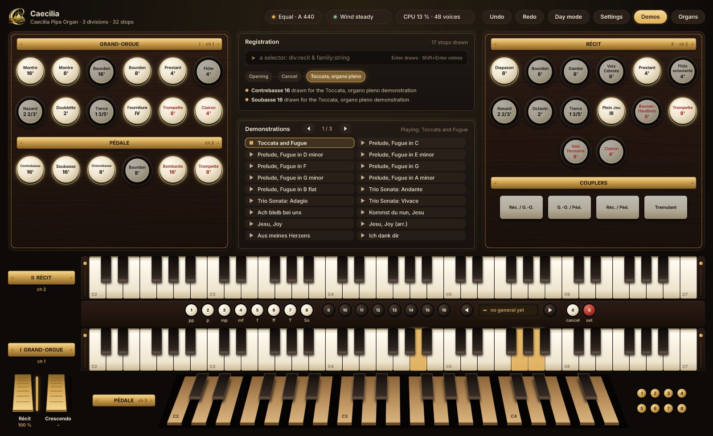

<!--
SPDX-License-Identifier: Apache-2.0
Copyright (c) 2026 Alesson Queiroz and the Caecilia contributors.
-->

<p align="center">
  
</p>

<h1 align="center">Caecilia</h1>

<p align="center">
  <strong>An open-source virtual pipe organ in Rust. No samples: every pipe is calculated as it sounds, on a wind that lives.</strong>
</p>

<p align="center">
  <a href="https://github.com/alessonqueirozdev-hub/Caecilia/actions/workflows/build.yml"></a>
  <a href="https://github.com/alessonqueirozdev-hub/Caecilia/releases"></a>
  <a href="LICENSE"></a>
  <a href="CONTRIBUTING.md"></a>
</p>

<p align="center">
  <a href="https://github.com/alessonqueirozdev-hub/Caecilia/releases">Download</a> ·
  <a href="https://manguebyte.org/caecilia/#videos">Hear it</a> ·
  <a href="https://manguebyte.org/caecilia/">Website</a> ·
  <a href="CONTRIBUTING.md">Contribute</a> ·
  <a href="docs/ROADMAP.md">Roadmap</a>
</p>



> **Early alpha.** Caecilia plays today, as a standalone app and as VST3 and CLAP
> plugins, with a Windows installer. The sound is the main work in progress, and
> this is the best moment to help shape it.

## Built on Manguebyte

Caecilia uses the [Manguebyte Audio Framework](https://manguebyte.org) as its core:
its DSP, plugin formats, audio devices and the toolkit the console is drawn with all
come from there. The two are developed together, so improving Caecilia often means
improving Manguebyte, and **contributing to Caecilia is contributing to Manguebyte
too**.

## Why Caecilia

- **Modeled, not sampled.** Every rank speaks with its own additive voice:
  staggered onsets, chiff, mixtures that break back, drift.
- **The wind is alive.** Every pipe draws on a windchest fed by a modeled bellows.
  A full chord sags the wind and the pipes answer in pitch, level and brightness.
  The tremulant shakes the wind, not the volume.
- **Any organ.** An organ is a [JSON file](docs/ORGAN_FILE.md) of windchests, ranks,
  divisions, stops and couplers, and it changes live, without a click. The Caecilia
  Pipe Organ is built in: French in style, two manuals and pedal, 32 stops.
- **A console that is an organ console.** Drawstop jambs, general pistons, swell
  and crescendo shoes, a pedalboard and wind gauges in millimetres of water, in a
  night or a day light. It is drawn natively, with no WebView.
- **Registration that thinks.** A selector language (`div:recit & family:string`)
  draws stops by their nature, undo and redo walk the history, and every stop can
  say why it is drawn.
- **Models, one press away.** Ready-made sounds, from a Récit oboe to a Baroque
  organ to the tutti, each drawing its stops and sending your keyboard to the right
  manual. Any key of your keyboard can choose one.
- **Plays without a keyboard.** Bach demonstrations draw their own stops and play
  themselves, and a tour sounds every stop alone. With one MIDI keyboard, keys you
  choose switch between the manuals or play both.
- **Real-time safe, and proved.** Nothing on the audio thread allocates, locks or
  waits, and tests with a counting allocator check it.

## Try it

Download the installer from [Releases](https://github.com/alessonqueirozdev-hub/Caecilia/releases).
Windows is available now. Linux and macOS will follow once the console runs there.
The installer is not signed yet, so Windows SmartScreen may warn you: choose
**More info**, then **Run anyway**.

## Build it

You need [Rust](https://rustup.rs) 1.85 or newer. Caecilia is developed side by side
with its framework, [Manguebyte](https://github.com/alessonqueirozdev-hub/manguebyte),
so clone both into the same folder:

```bash
git clone https://github.com/alessonqueirozdev-hub/manguebyte.git
git clone https://github.com/alessonqueirozdev-hub/Caecilia.git
cd Caecilia
```

Then play the organ:

```bash
cargo run --profile caecilia-release -p caecilia-plugin --features standalone --bin caecilia
```

Or run every test:

```bash
cargo test --profile caecilia --workspace
```

The first build compiles the whole framework, so it takes a while and a few
gigabytes of disk. No test opens an audio device.

## Help build it

You don't have to write Rust to help. Organists, sound designers, testers and
translators are as welcome as programmers:

- **Listen and report.** Tell us what doesn't sound like an organ, and which stop.
  [Report the sound](https://github.com/alessonqueirozdev-hub/Caecilia/issues/new?template=sound_report.yml)
- **Voice an organ.** Organs are JSON files you can write and share.
  [Read the format](docs/ORGAN_FILE.md)
- **Try it in your DAW.** Testing in real hosts and on real hardware helps a lot.
  [Report a bug](https://github.com/alessonqueirozdev-hub/Caecilia/issues/new?template=bug_report.yml)
- **Write code.** DSP, the console, new platforms, tests.
  [Good first issues](https://github.com/alessonqueirozdev-hub/Caecilia/labels/good%20first%20issue)

[CONTRIBUTING.md](CONTRIBUTING.md) has the details, and the [roadmap](docs/ROADMAP.md)
says where it's going. Issues may be written in any language. What you find here
often reaches [Manguebyte](https://github.com/alessonqueirozdev-hub/manguebyte) too,
and every program built on it gains from that.

## How it fits together

| Crate | What it is |
|---|---|
| [`caecilia-model`](crates/caecilia-model) | The organ model, its JSON file and the built-in organs |
| [`caecilia-wind`](crates/caecilia-wind) | Bellows, windchests, trunks and tremulants |
| [`caecilia-synth`](crates/caecilia-synth) | The pipe voices |
| [`caecilia-engine`](crates/caecilia-engine) | Keys over ranks and couplers, chests and swell boxes |
| [`caecilia-registration`](crates/caecilia-registration) | Selectors, history, generals, plenum and explanations |
| [`caecilia-plugin`](crates/caecilia-plugin) | The plugin, the console, the demonstrations and the standalone app |
| [`caecilia-installer`](crates/caecilia-installer) | The installer, also written in Rust |
| [`caecilia-tools`](crates/caecilia-tools) | Comparison against 1.x, and other development tools |

The [documentation index](docs/README.md) lists every document and how current it
is. The 1.x C++/JUCE instrument is kept at the tag
[`v1-cpp-final`](https://github.com/alessonqueirozdev-hub/Caecilia/tree/v1-cpp-final);
what it measured is frozen in `reference/cpp-1.x`, which 2.0 is tested against.

## License and provenance

Caecilia is licensed under the [Apache License 2.0](LICENSE) (see also
[NOTICE](NOTICE) and [THIRD_PARTY_NOTICES.md](THIRD_PARTY_NOTICES.md)). Apache-2.0
was chosen for its explicit patent grant, since audio DSP is a field where
third-party patents exist. Manguebyte is MIT OR Apache-2.0.

The algorithms are written from public literature and standard mathematics. **No
GPL source (GrandOrgue, Aeolus or otherwise) was referenced or copied.** Other
instruments are cited only by their observable behaviour and public documentation.
If you believe any part infringes, please open an issue and it will be addressed.

Created by Alesson Queiroz (alessonqueiroz.dev@gmail.com) and the Caecilia
contributors. By contributing, you agree that your contributions are licensed under
Apache-2.0. Everyone participating follows the [Code of Conduct](CODE_OF_CONDUCT.md).
